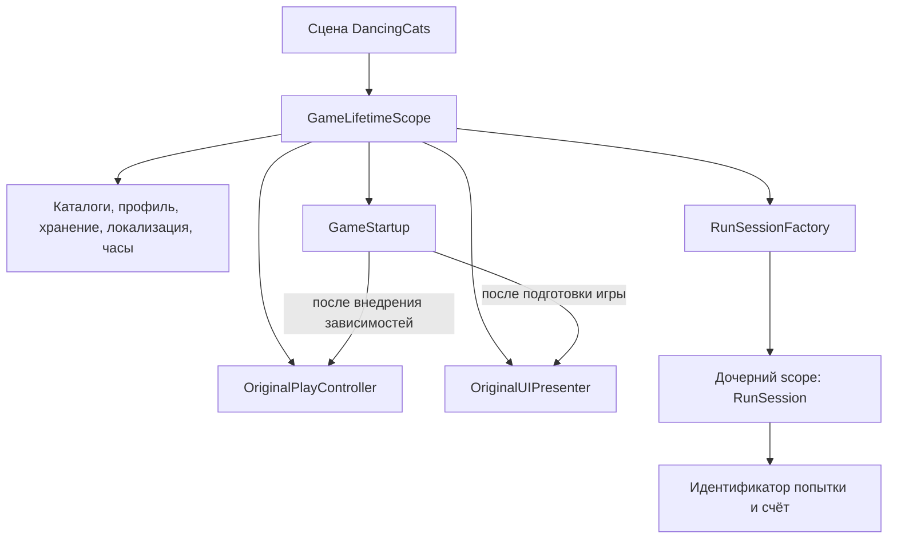

# DI и время жизни объектов

Активный проект: `DancingCatsClone`, Unity 6000.5.4f1. Требования от 21.10.2026:
DI-контейнер, явные зависимости, отсутствие собственных глобальных `.Instance`,
возможность расширять игру. Исторический проект `The Cat` сохраняется отдельно.

Установлен **VContainer 1.19.0**, ревизия
`5401e5a7ebc4980a2b82141ffc26391a6547edd7`, через Unity Package Manager Client API.
Зависимость закреплена в manifest и lock-файле. Лицензия пакета — MIT;
это внешняя библиотека, её исходники не переименовываются.

## Как запускается игра

`GameLifetimeScope` содержит ссылки на контроллер, UI, EventSystem и Volume,
заданные в сцене. `GameServices.Register` описывает общий граф сервисов.
Вызовы `Resolve` разрешены только в этой точке сборки и в фабрике попыток.
Контроллер и представления не получают контейнер.

`[Inject] Construct(...)` передаёт зависимости компонентам. `GameStartup` запускает
контроллер, затем UI. `Update` до инициализации не работает с игровым состоянием.
Скрытый запасной запуск с самостоятельным созданием профиля удалён.

## Время жизни

| Данные и сервисы | Владелец | Когда освобождаются |
|---|---|---|
| Профиль, ресурсы, каталоги, локализация, календарь, DSP-часы | Общий контейнер игры | При уничтожении scope сцены |
| Контроллер, UI, EventSystem, цели настроек рендера | Игровая сцена | При выгрузке сцены / выходе из Play Mode |
| Счёт и ID попытки | Дочерний контейнер `RunSession` | При следующей попытке или уничтожении родителя |
| Изменяемая карта | Контроллер текущей сцены | При замене песни/карты; каждый LoadMap возвращает новый объект |
| Плитки, модель, окружение, превью | Компоненты сцены | По существующим правилам создания/смены и при уничтожении родителя |

Сейчас игра состоит из одной сцены, поэтому она также владеет общими сервисами.
При появлении отдельных сцен меню и игры общие регистрации нужно перенести
в постоянный родительский bootstrap scope. Сценические компоненты и фабрика
попыток останутся в дочерних scope. Глобальный контейнер для этого не нужен.

`RunSession` пока владеет ID и счётом. Движение и остальные поля попытки ещё
находятся в контроллере; это не заявление о завершении всей декомпозиции игры.

## Границы сервисов

- `ISongCatalog`: список песен, свежая карта, аудио и иконки.
- `IGameResources`: граница Unity Resources; позволяет позднее заменить загрузку
  без изменения потребителей.
- `IAudioClock`: DSP-время Unity. `PlayScheduled` и расчёт синхронизации сохранены.
- `IProfileStore`: чтение/запись JSON профиля; `IPlayerPreferences`: простые настройки.
- `ProfileServiceFactory`: восстановление профиля из переданных хранилища,
  каталога, календаря и идентификатора приложения.
- `UiLocalization`, `RoleMotionCatalog`, `ThemeCatalog`: кэши внутри контейнера,
  без статических изменяемых словарей.
- `SceneRenderSettings`: известные заранее Volume и текущая камера; поиск сцены
  при каждом попадании больше не выполняется.

Параметры конкретной плитки передаются через `Initialize`, параметры превью —
через `Bind`. Регистрировать каждый тайл в контейнере или вызывать Resolve
в кадре не требуется. Статические функции разбора старого формата сохранены
как совместимый вход для Editor-инструментов; они не хранят глобальное состояние.

## Как добавлять систему

1. Передать необходимые сервисы в конструктор обычного C# класса.
2. Зарегистрировать класс в `GameServices` и явно выбрать lifetime.
3. Для Unity-компонента использовать `[Inject] Construct(...)` и зарегистрировать
   компонент в scope. При необходимости добавить явный шаг запуска.
4. Подписки снимать при уничтожении владельца. Ресурсы дочерней попытки
   освобождать через её scope или явного владельца.
5. Проверять поведение с подставными ресурсами и хранилищем, не меняя реальные
   пользовательские сохранения.

Запрещены собственные `static Instance`, статический реестр сервисов и доступ
к контейнеру из игровых правил/представлений. `Lifetime.Singleton` означает
один объект на контейнер, а не глобальный доступ. Константы, чистые статические
вычисления и имена Unity API (`BindingFlags.Instance`, `CreateInstance`) допустимы.

## Совместимость и проверка

Сохранены GUID сцены и скриптов, ссылки на контент, ключ сохранения
`DancingCatsClone.v1.progression`, JSON schemaVersion 1, музыка и карты.
`CloneSceneBuilder` создаёт сцену сразу с DI-привязками. Окружение, актёр и
путь теперь дочерние объекты контроллера и уничтожаются вместе с ним.

- [x] Пакет установлен и закреплён.
- [x] Внедрение зависимостей перед явным запуском.
- [x] Отдельный scope попытки и освобождение предыдущей.
- [x] Каталоги и локализация без глобальных изменяемых кэшей.
- [x] Сериализованные привязки сцены, обновлённый генератор сцены.
- [x] Editor-проверки изоляции сервисов, сохранений, карт, локализации и disposal.
- [x] Существующие проверки правил, визуальных привязок, контента и генератора карт.
- [x] Полная песня 157,153 с в Play Mode: реальный ввод, пауза/возобновление,
  все длинные и подвижные плитки, финиш, сохранение результата, однократная награда.
- [x] Повторный вход в Play Mode: семь панелей, настройки, пауза/возобновление,
  награды и сохранения; без ошибок выполнения.
- [x] После обоих прогонов восстановлены Edit Mode, прежняя сцена, выделение,
  настройки ввода и пользовательское сохранение.

Проверки запускаются локальной очередью Editor: `di-checks`, `playtest`, `di-menus`.
Отчёты сохранены в `outputs/DI-Migration` рабочего каталога задачи.
Сборки приложения не создаются. Замеры FPS/GC в Profiler в эту миграцию не входят;
контейнер сам по себе не является доказательством ускорения игры.

Это внедрение DI, а не полная замена всех старых названий, графики и игровых
реализаций. Самостоятельный дизайн и дальнейшая декомпозиция — следующий этап.
