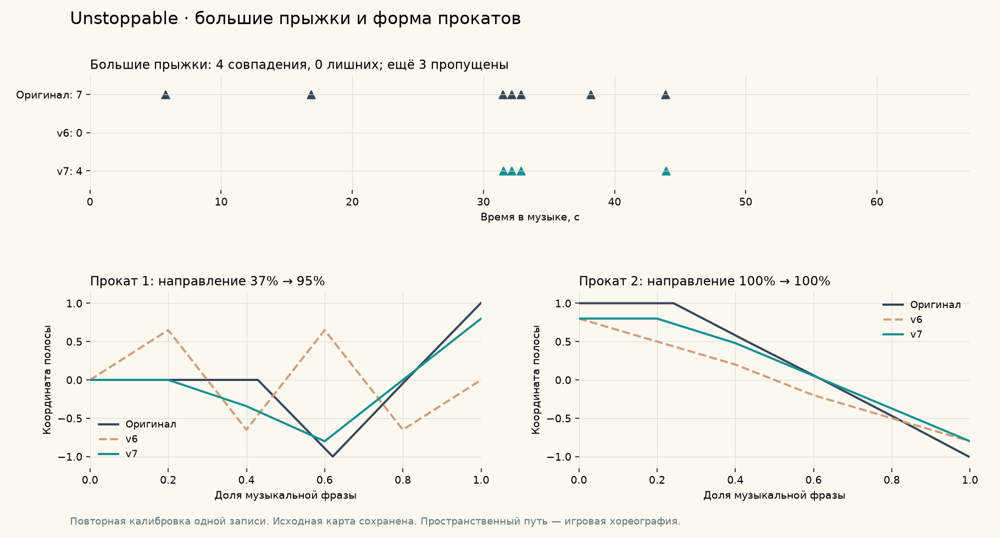

# Калибровка генератора: Unstoppable, v7

Генератор распознаёт **4 из 7 больших прыжков без лишних**, сохраняя все
14 длинных плиток и оба проката. Первый прокат теперь совпадает по направлению
на 94,7% вместо 36,8%; средняя ошибка его полосы уменьшилась с 0,557 до 0,126.
F1 событий с допуском 80 мс вырос с 0,84866 до 0,86228.

Оригинал и музыка сохранены; опубликован отдельный `UnstoppableGeneratorTest`.
Также заново проанализирована наша песня: автоматический `Always Remember
Meow` содержит 13 длинных плиток, 2 проката и 1 большой прыжок. Прежняя
ручная разметка сохранена. Новый вариант плотнее и подготовлен для сравнения.

[Полный отчёт v7](V7_FLIGHTS_AND_PATHS.md) объясняет правила, результаты,
пропущенные прыжки, новую карту, проверку временной оси и ограничения.
[Целостность файлов и сводки](v7-integrity.json),
[оценка событий и поддержек](candidate.json),
[каждый большой прыжок](v7.big-jumps.csv).

Это повторная калибровка одной записи, а не восстановление исходного
генератора и не проверка точности на новых песнях. Три больших прыжка
пока пропущены. Пространственная форма прокатов — самостоятельная игровая
хореография; её временные границы определяются по аудио.

[Исторический отчёт v6](V6_SUSTAINS.md) описывает предыдущую итерацию,
нашедшую все длинные поддержки. Сборки игрока не создаются.

Полные прогоны в Unity: [Unstoppable, 67 с](unity-comparison-v7-playtest.txt)
и [наша песня, 157 с](unity-custom-v7-playtest.txt) — PASS.
Меню всех трёх героев проверено в трёх размерах окна — 9/9 PASS.
