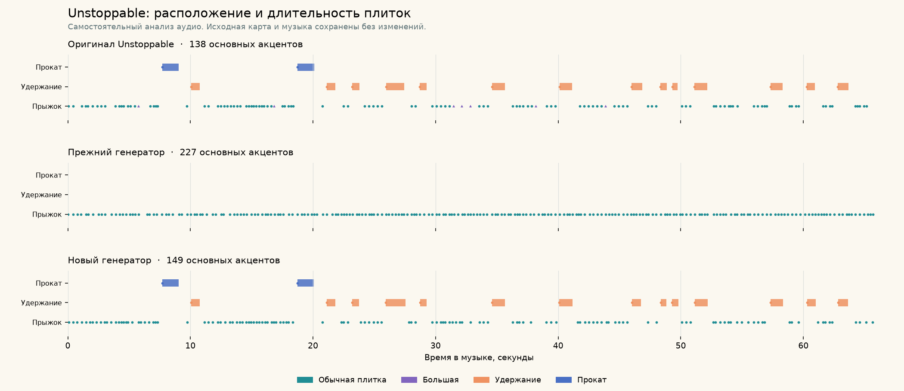

> Исторический отчёт v6, до распознавания больших прыжков. Текущий результат — в [README.md](README.md).

# Калибровка генератора: Unstoppable, v6

В тестовом уровне **Unstoppable · тест генератора** теперь найдены все
четырнадцать Hold и оба Follow. Лишних длинных поддержек нет. Все шестнадцать
интервалов проходят проверку обеих границ с допуском 150 мс и `IoU >= 0,5`.
Оригинальная карта и музыка не изменены; изменяется только отдельный
`UnstoppableGeneratorTest`.

Это результат для временных интервалов на данной записи. **Вся карта не
идентична оригиналу**: обычные входы отличаются, BigJump не распознаются
автоматически — ноль против семи в эталоне. Маршруты Follow также отличаются.
Параметры дорабатывались на этой песне; точность на новых песнях не проверена.

## Как получается карта

`pcm-vocal-phrase-chart-v6` получает PCM и независимые измерения того же аудио.
Название, ID песни, эталонные таймкоды и исходная карта не участвуют в
генерации. Эталон читается отдельно при оценке.

1. Спектральный анализ с окном Hann 1024 и шагом около 10 мс находит реальные
   атаки. Усредняются модули спектров отдельных каналов: противофазное стерео
   не уничтожает сигнал. Локальные пороги подавляют слабые и близкие всплески.
2. Follow ищется по повторяющимся спектрально непрерывным артикуляциям.
   Измеряются границы фразы; движение по полосам задаёт самостоятельная
   игровая палитра. Подробности — [PHRASE_GENERATOR.md](PHRASE_GENERATOR.md).
3. Для Hold локальный UVR Kim Vocal 2 выделяет голос, а Spotify Basic Pitch
   измеряет высоту, активность и атаки. Постоянная высота не обязательна:
   например, первый Hold содержит F4 → E♭4 → C4. v6 распознаёт нисходящий
   распев, опорную ноту с окончанием, возвратный орнамент и короткий восходящий
   вход в верхний регистр.
4. Конец уточняется по RMS голоса и измеренной спектральной атаке. Подтверждённые
   Hold/Follow подавляют обычные плитки внутри интервала. Входы вокала,
   пропущенные смешанным спектром, сохраняются отдельно; неподтверждённые
   кандидаты не попадают в общую сетку прыжков.

Короткая неуверенность оценки высоты отличается от настоящей тишины: более
длинный провал confidence разрешён только пока продолжается реальная энергия
голоса. Возвратный орнамент отделён от полутонового вибрато; мягкий полутоновый
спад завершает основную ноту, не продлевая платформу через слабый хвост.
Верхний регистр для восходящих входов вычисляется по уверенно звучащим нотам
самой записи; короткий выброс pitch его не меняет.
Восходящий вход и нисходящий glide дополнительно требуют слышимой энергии до
конца опоры: непрерывные 60 мс ниже 10% пика RMS фразы отвергают кандидата.
Нижняя граница пика 0,005 исключает поддержку по одному pitch при нулевом RMS.

У двух жестов окончание задаёт **музыкальная игровая политика**. Верхняя
каденция заполняет настоящую вокальную паузу до нижнего ответа; нисходящий
glide оставляет полёт к следующей независимо подтверждённой опоре. Это не
утверждение, что голос звучит до конца плитки. Используются измеренный период
пульса и длина опорной ноты. Без периода эти две ветки отключены; остальные
двенадцать Hold находятся по вокальным признакам.

Модели запускаются **только при локальной подготовке данных**. Editor читает
проверяемый `.voice.json`; игра проигрывает готовую карту без ML и спектрального
анализа. Без вокального кэша остаётся ветка v4. Автоматическое присвоение
BigJump по одному временному промежутку не включено: оно давало много ошибок.

## Результаты и история

| Показатель | v2: RMS | v3: спектр | v4: фразы | v5: вокал | v6: расширенные жесты |
| --- | ---: | ---: | ---: | ---: | ---: |
| Элементы, включая служебные | 229 | 175 | 178 | 174 | 161 |
| F1 всех событий, 40 мс | 0,42967 | 0,65294 | 0,66082 | 0,67638 | **0,71217** |
| F1 всех событий, 80 мс | 0,61381 | 0,76471 | 0,78947 | 0,81050 | **0,84866** |
| F1 последней трети, 80 мс | 0,58065 | 0,79167 | 0,79167 | 0,82474 | **0,87755** |
| MAE совпавших событий, 80 мс | 28,65 мс | 23,11 мс | 23,51 мс | 23,42 мс | 23,56 мс |
| Hold: правильных / предложенных | 0 / 0 | 2 / 3 | 2 / 2 | 7 / 7 | **14 / 14** |
| Follow: правильных / предложенных | 0 / 0 | 0 / 0 | 2 / 2 | 2 / 2 | **2 / 2** |

Исторические отчёты: [baseline.json](baseline.json), [v3.json](v3.json),
[v4.json](v4.json), [v5.json](v5.json). Отчёт этой итерации — [v6.json](v6.json).
Baseline не перегенерируется новым алгоритмом. Сохранены также
[v5.supports.csv](v5.supports.csv), [v5.vocal-metrics.json](v5.vocal-metrics.json)
и [v5.vocal-provenance.json](v5.vocal-provenance.json).

F1 учитывает пропуски и лишние события; 0,84866 не означает 85% полной
идентичности уровня. В эталоне 162 элемента, 163 события и 138 основных
музыкальных входов; в v6 — 161 элемент, 174 события и 149 входов. Служебные
маркеры, выходы и точки проката не равны новым прыжковым плиткам.
`logicalSupports` отдельно оценивает музыкальные входы.

Последняя треть начинается с 44,669388 с, но остаётся частью той же песни.
Обе части просматривались при доработке, поиск повторов анализирует запись
целиком. Это **не слепой тест и не проверка на новых песнях**.

### Длинные плитки и прокаты

| Показатель v6 | Hold | Follow |
| --- | ---: | ---: |
| В эталоне | 14 | 2 |
| Найдено / правильных / лишних | 14 / 14 / 0 | 2 / 2 / 0 |
| Recall | 1,00 | 1,00 |
| MAE начала | 19,18 мс | 5,98 мс |
| MAE конца | 42,33 мс | 22,35 мс |
| MAE длительности | 50,09 мс | 19,79 мс |
| Средний IoU совпавших интервалов | 0,92070 | 0,97920 |

Входы сопоставлены с допуском 80 мс. Строгая проверка поддержки требует
правильного типа, ошибок обеих границ не больше 150 мс и `IoU >= 0,5`.
Сопоставление взаимно однозначное: один эталонный интервал нельзя засчитать
нескольким предложениям. Все шестнадцать поддержек показаны в
[candidate.supports.csv](candidate.supports.csv); отдельная оценка вокального
детектора — [vocal-final-metrics.json](vocal-final-metrics.json).

В v5 средний IoU 0,93355 относился только к семи найденным Hold, а покрытие
всех четырнадцати составляло 0,46677. В v6 учтены все четырнадцать: средний IoU
и `referenceCoverageIoU` равны 0,92070. Рост покрытия не означает точного
совпадения каждой длительности.

Форма Follow приблизительна. Согласие направления движения для двух фраз —
36,8% и 100%; средняя ошибка координаты полосы — 0,557 и 0,276. Точные границы
не доказывают восстановление исходной траектории. Theme также не
восстанавливается как отдельный оригинальный тип.

## Воспроизведение и целостность

Анализ получает **тот PCM, который воспроизводит Unity**. У исходного
AudioImporter уже включён Vorbis. Его настройки сохранены: Python-декодер
WAV и `AudioClip.GetData` дают разные PCM-хеши. Editor экспортирует настоящие
float32 little-endian сэмплы; CLI проверяет их метаданные и SHA.

| Объект | SHA-256 |
| --- | --- |
| Оригинальная карта | `277e5fd678a41323273dd786f32450291338d4edf4752d9ff83939b52548de90` |
| Исходный WAV | `7fdf15c8df324f3dff96d1992248081611f0751a2ad454013f719d15bcf91d6b` |
| Настоящий Unity GetData PCM | `88ea37d6fc9b91863509c174e1aad914cff14704e6be6d20a57b5ffe21429102` |
| Канонический digest вокальных признаков | `1087a84b2019acb19e88794e6286342e825530b8d89d30c5f619858dbc85ebae` |

Кэш проверяет PCM, частоту, каналы, число сэмплов, происхождение моделей,
конечность значений, порядок времени и целостность массивов. Digest чисел
использует int64 с точностью 1e-8: различия JSON-парсеров не меняют хеш.
Чужой PCM, изменённый RMS и нечисловой шаг отвергаются. v6 использует прежний
проверенный кэш v5; новые модели и дополнительная генерация музыки не нужны.

Подготовка: [Tools/RhythmAnalysis/README.md](../../../Tools/RhythmAnalysis/README.md).
Команда Unity: **Assets → Dancing Cats → Export selected audio PCM for vocal analysis**.
`analyze_vocal_holds.py` принимает `--decoded-pcm` и `--decoded-metadata`, не
читая эталон. Для CLI-повтора предложений передаётся `--beat-period` с тем же
измеренным периодом, что у генератора; здесь это 0,52 с. Этот аргумент влияет
на две музыкальные политики, а не на сами признаки. Unity передаёт период
автоматически. Веса и стем остаются в игнорируемой `Library`; в репозитории —
CLI, лицензии, компактные признаки и [vocal-provenance.json](vocal-provenance.json).

Обе ONNX-модели работают локально. Код проекта UVR лицензирован MIT;
авторы просят указывать их при использовании публичной модели Kim Vocal 2
(около 64 МБ), веса здесь не распространяются. Basic Pitch — 230 КБ,
Apache-2.0. Источники, SHA и уведомления приведены в
[THIRD_PARTY_NOTICES.md](../../../Tools/RhythmAnalysis/THIRD_PARTY_NOTICES.md).
Аудио не отправляется в сеть, Runway не использовался. Исходная подготовка
67-секундной записи заняла около 31 с CPU на выделение вокала и 1,2 с на ноты;
доработка v6 повторного запуска моделей не потребовала.

`OriginalChartCalibration.RunChecks()` повторяет регрессии и оценку;
`GenerateUnstoppableComparison()` сохраняет только тест с защитой оригинала
по хешам. `PcmVocalIntegrationValidation.RunChecks()` проверяет реальные
GetData/кэш, детерминизм, входы, отсутствие перекрытий и независимые флаги.

`PcmVocalGestureValidation.RunChecks()` и
[`test_vocal_holds.py`](../../../Tools/RhythmAnalysis/test_vocal_holds.py)
используют одни [26 контрфактических наборов измерений](../../../Tools/RhythmAnalysis/gesture_fixtures.json):
продолжающийся голос против тишины, орнамент против вибрато, восходящий вход
против обычной высокой ноты, каденция против вмешивающегося слога, glide
с подтверждённой следующей опорой и без неё. Есть перенос по высоте и выброс
pitch; восходящий вход и glide проверены также с настоящей паузой 180 мс и
полностью нулевым RMS. Это тесты правил, а не независимые записи и не оценка точности моделей.

## Игровая проверка

**Текущий v6: полный прогон 67,004 с в Unity — PASS.** Подтверждены реальные
контакты на Hold/Follow, результат, повтор и отсутствие runtime-ошибок.
Editor отдельно подтвердил все 14 Hold, оба Follow, обе границы, идентичность
GetData PCM и 26 контрфактических наборов. Опубликован только тестовый уровень;
оригинал сохранён. Сборка игры не создавалась.
[Отчёт v6](unity-comparison-v6-playtest.txt).

Исторический v5 пройден в Unity за 67,004 с 24.10.2026, 21:51:18: настоящий
ввод, семь удержаний, прокаты, пауза/DSP, три звезды, повтор и возврат.
Профиль и сцена восстановлены, сборка не создавалась.
[Отчёт v5](unity-comparison-v5-playtest.txt).

Старый [unity-comparison-playtest.txt](unity-comparison-playtest.txt)
сохранён как история v3; его Follow N/A не описывает текущую версию.
Работоспособность карты и совпадение её разметки оцениваются отдельно.
