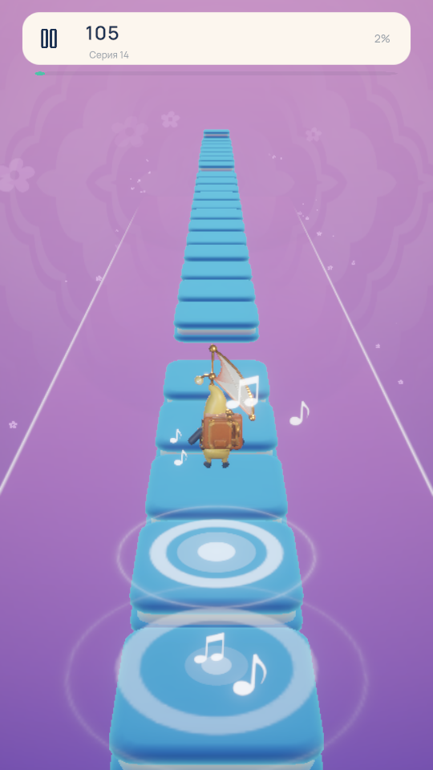

# Генератор v7: большие прыжки и прокаты

25 октября 2026. Оригинальные карты и музыка сохранены. Изменяются только
`UnstoppableGeneratorTest` и пользовательский `AlwaysRememberMeowCat`.

| Проверка Unstoppable | v6 | v7 |
| --- | ---: | ---: |
| BigJump: правильных / предложенных / эталон | 0 / 0 / 7 | **4 / 4 / 7** |
| Hold: правильных / предложенных / эталон | 14 / 14 / 14 | **14 / 14 / 14** |
| Follow: правильных / предложенных / эталон | 2 / 2 / 2 | **2 / 2 / 2** |
| F1 всех событий, допуск 80 мс | 0,84866 | **0,86228** |
| F1 всех событий, допуск 40 мс | 0,71217 | **0,72455** |
| Элементы / события | 161 / 174 | **158 / 171** |
| Первый прокат: совпадение направления | 36,8% | **94,7%** |
| Первый прокат: средняя ошибка полосы | 0,557 | **0,126** |
| Второй прокат: совпадение направления | 100% | **100%** |
| Второй прокат: средняя ошибка полосы | 0,276 | **0,131** |

Это повторная калибровка одной записи. F1 не означает процент идентичности
игры; исходный алгоритм автора не восстановлен. Три больших прыжка на
5,769 / 16,841 / 38,190 с пока пропущены. Их вокальный рисунок похож и на
некоторые обычные прыжки. Средняя ошибка начала четырёх совпавших BigJump —
32,20 мс. По каждому месту — [таблица](v7.big-jumps.csv).

## Принципы

`PcmFlightAnalysis` получает проверенные признаки того же PCM, реальные
спектральные атаки, измеренный период пульса и интервалы Hold/Follow.
Устойчивая вокальная фраза в верхней части регистра записи, настоящее
затухание и следующая измеренная атака могут образовать большой полёт.
Длительности соотносятся с пульсом. Различие регистров требует двух групп
нот продолжительностью хотя бы 200 мс; единичного выброса недостаточно.

`BigJump` обозначает плитку **отталкивания**, длительность которой остаётся
нулевой. Длина полёта получается из расстояния до следующей посадки.
Мелкие атаки аккомпанемента внутри подтверждённой фразы могут исчезнуть,
но предыдущий вокальный слог, новая вокальная атака и длинные поддержки
защищены. Один длинный промежуток сам по себе не означает BigJump.

Границы Follow измеряет прежний детектор повторяющихся непрерывных фраз.
Путь задаёт самостоятельная игровая хореография: выдержка у входа и один
широкий разворот; повторная фраза получает обратный плавный проход.
Координаты оригинала в генератор не передаются. Одинаковая музыка в оригинале
имеет разные пространственные маршруты: точное восстановление авторского
пути только по звуку не утверждается.

## Наша песня

Прежний MP3 длится **157,153 с**. Новый явный режим
`preferAuthoredScore=false` запускает анализ PCM. Файл прежней ручной
разметки сохранён без изменений и доступен обычному режиму генерации.

| | Прежняя ручная карта | Автоматический v7 |
| --- | ---: | ---: |
| Обычные прыжки | 202 | 357 |
| Длинные плитки | 20 | 13 |
| Прокаты | 3 | 2 |
| Большие прыжки | 0 | 1 |
| Элементы / события | 245 / 301 | 385 / 397 |
| Самый длинный полёт | 1,942 с | 1,906 с |

Автоматический вариант плотнее; музыкальное качество нужно оценить при
прослушивании. Детектор пульса выбрал 65,22 BPM, близко к половине прежней
разметки 130 BPM. Это метрическая неоднозначность; скорость музыки и
игровые часы сохранены.

Для новой записи локально подготовлены признаки из настоящего
`AudioClip.GetData`. Исправлена ошибка склейки окон Basic Pitch: временная
ось длинной записи заканчивалась на 1,061 с раньше аудио. Теперь строки
привязаны к настоящему положению входного окна; последняя оценка находится
за 8,889 мс до конца. Новый кэш имеет отдельную версию. Исторический
вокальный кэш Unstoppable v1 сохранён для сравнения с теми же измерениями
v6; его ограничения описаны в
[документации анализа](../../../Tools/RhythmAnalysis/README.md).

`PcmSparsePhraseAnalysis` обрабатывает промежутки более 1,95 с. Он может
восстановить пропущенный слышимый вокальный вход или использовать измеренную
устойчивую многогармоническую ноту как поддержку. Конец ограничен измеренным
окончанием ноты и следующей существующей атакой. Тишина не заполняется
плитками по таймеру. Шесть таких решений закрыли недопустимые промежутки,
включая инструментальное окончание. После Follow используется координата
его **выхода**, чтобы не возвращаться к входной полосе.

## Доказательства

- [Текущая оценка](candidate.json), [предыдущая v6](v6.json),
  [длины поддержек](candidate.supports.csv).
- [Целостность и обе карты](v7-integrity.json): все 410 защищённых файлов
  сохранены, включая исходные карты, музыку, ручную разметку и четыре ранее
  изменённых пользователем файла.
- 16 контрфактических случаев полёта, три случая безопасного объединения,
  проверки хореографии, редких фраз и конечной полосы Follow; четыре проверки
  времени окон и 26 прежних вокальных случаев.
- Платная генерация, загрузка аудио в сеть и сборка игрока не использовались.

## Проверка в игре

Оба обновлённых уровня полностью пройдены в открытом Unity Editor:
[Unstoppable, 67,004 с](unity-comparison-v7-playtest.txt) и
[наша песня, 157,153 с](unity-custom-v7-playtest.txt). Подтверждены настоящие
посадки, поддержки и маркеры проката, DSP/пауза, три звезды и повтор.
Прогоны не использовали перемотку или телепортацию. Профиль, ввод, сцены и
выбор Editor восстановлены. Это проверка механики, а музыкальную уместность
новой более плотной карты нужно оценить при прослушивании.

[Финальные команды](unity-v7-actions.txt),
[меню: девять случаев](unity-v7-menu-checks.txt).
Пружинящее сжатие учитывается отдельно от нормализованного базового роста;
проверки всех настоящих вершин и положения стоп сохранены. Модели и текстуры
не изменялись; [новое движение и ролики](../../Design/RadioArchipelago/RigReview/MotionV2/README.md).

