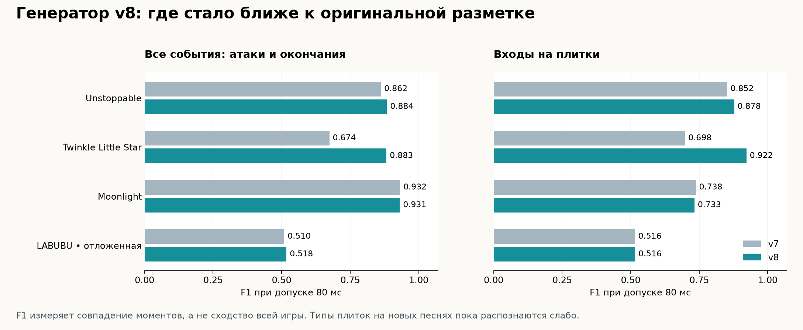
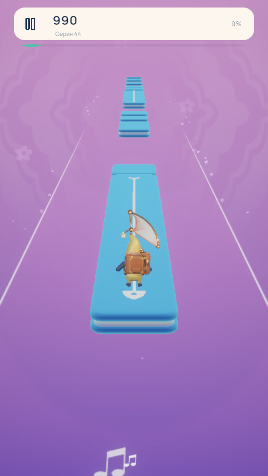

# Генератор v8: музыкальные атаки и проверка на других песнях

25 октября 2026. В тестовой Unstoppable теперь распознаны **все 7 больших
прыжков без лишних**, сохранены 14 длинных плиток и оба проката. Наша песня
перегенерирована тем же алгоритмом. Оригинальные уровни, аудио, прежняя
ручная партитура и принятая анимация персонажей сохранены. Сборки игрока
не создавались.

Это самостоятельная реализация `pcm-vocal-phrase-chart-v8`. Она стала ближе
к эталонной Unstoppable и лучше находит быстрые инструментальные ноты.
Проверка других записей показывает, что воспроизведение всех типов плиток
оригинальной игры ещё не достигнуто.

## Результаты

F1 объединяет точность и полноту совпадений событий с допуском 80 мс.
Это **не процент похожести игры**: совпадение времени не доказывает
правильный тип плитки, её длительность или пространственный маршрут.
Отдельная метрика логических входов сравнивает вход в поддержку целиком,
без превращения внутренних маркеров проката в самостоятельные плитки.

| Запись | Назначение | F1 событий v7 → v8 | F1 логических входов v7 → v8 |
| --- | --- | ---: | ---: |
| Unstoppable | Повторная калибровка | 0,86228 → **0,88415** | 0,85211 → **0,87770** |
| Twinkle Twinkle Little Star | Калибровка плотной карты | 0,67424 → **0,88254** | 0,69828 → **0,92226** |
| Moonlight | Калибровка коротких поддержек | 0,93227 → **0,93117** | 0,73786 → **0,73267** |
| LABUBU Songs | Отложенная запись | 0,50973 → **0,51779** | 0,51572 → **0,51613** |

У Moonlight есть небольшая регрессия, а улучшение на отложенной записи
невелико. Эти результаты включены в отчёт вместе с успешными.
Геометрические ограничения всех четырёх карт пройдены.

| Типы на Unstoppable | v7: совпало / создано / эталон | v8: совпало / создано / эталон |
| --- | ---: | ---: |
| Большие прыжки | 4 / 4 / 7 | **7 / 7 / 7** |
| Длинные плитки | 14 / 14 / 14 | **14 / 14 / 14** |
| Прокаты | 2 / 2 / 2 | **2 / 2 / 2** |

Средняя ошибка начала большого прыжка — 25,23 мс. Новые полёты также
сопоставлены с последующей посадкой. Путь первого проката сохранил 94,7%
совпадения направления и среднюю ошибку полосы 0,126; второго — 100% и 0,131.
Это результаты v7, сохранённые в v8, а не новое улучшение маршрутов.

Типы плиток на остальных песнях пока распознаются значительно хуже:

- Twinkle: ритмические входы восстановлены лучше, но из 25 эталонных
  BigJump и 9 Hold не распознан ни один. Их время часто покрыто обычными
  прыжками.
- Moonlight: создан 1 Hold, который не совпадает с 42 эталонными Hold.
  Многие исходные поддержки длятся около 0,292 с; текущий вокальный
  детектор ориентирован на более длинные устойчивые фразы. Высокий F1
  событий здесь не означает правильную длительность плиток.
- LABUBU Songs: распознан 1 из 20 BigJump, ни один из 4 Hold и 16 Follow.
  По этой отложенной записи параметры после оценки не подстраивались.

## Что изменилось в анализе

Генератор разделяет физические атаки полного микса и независимо измеренные
атаки переднего вокального голоса. Сначала прежние физические атаки
участвуют в определении границ поддержек и полётов. Затем обычные прыжки
проверяются по слышимым атакам отделённого голоса. Подтверждённые Hold,
Follow, отталкивание большого прыжка, его полёт и настоящая посадка защищены.
При слабой уверенности в высоте или отсутствии пригодных признаков
генератор сохраняет исходные физические события.

Для быстрых фраз добавлено распознавание повторных артикуляций. Вокальная
цепочка требует нескольких независимо подтверждённых атак. В инструментальном
фрагменте проверяется рост гармоник действительной ноты, включая тихую
мелодию под более громким басом. Ровный звук с хай-хэтом или широкополосным
ударом не должен превращаться в частую мелодическую цепочку. Старый интервал
отсева физических атак 160 мс сохранён; отдельный анализ допускает реальные
ноты примерно через 125 мс. Проверки включают повтор одной высоты,
меняющиеся ноты, противофазное стерео, ровный фон и ударные.

Новый вариант большого полёта использует устойчивую фразу в наиболее
частой уверенной высоте данной записи, подтверждённую атаку, фактическое
затухание и следующую посадку. Повторные слоги той же высоты, слабый или
неслышимый звук и пересечение существующих поддержек отвергаются. Вместе
с прежним правилом верхнего регистра это даёт 7/7 на Unstoppable.
Контрфактические проверки полётов расширены с 16 до 28 случаев.

Правила распознавания не используют имя песни, времена эталонных прыжков
или координаты исходной карты. В этом сравнении ручная партитура отключена.
Эталон читает отдельный оценщик после независимой генерации.

## Временная ось и происхождение признаков

Новая схема признаков `schemaVersion=2` добавляет `vocalAttackTimes`,
`vocalAttackConfidence` и версию `stem-high-flux-1`. Атаки измерены по
высокочастотному спектральному потоку действительно отделённого голоса,
а уверенность — по нейросетевому выходу в правильной временной позиции
входного окна Basic Pitch. SHA-256 покрывает новые массивы и версию.
Проверки отвергают подмену времени, уверенности, неизвестную версию,
несогласованные длины и нечисловые значения. Старые контрольные суммы
schema1 остаются совместимыми.

Unstoppable намеренно использует смешанную совместимую группу:
исторические измерения высоты и длинных фраз `vocal-phrase-1` сохранены,
а новые атаки получены на исправленной оси окон v2. Это явно записано
в `voiceAnalysisVersion`; старые измерения не выдаются за пересчитанные.
Классические массивы всех пяти записей сохранены при расширении схемы.

Измеренная разница старых и новых внутренних отметок Unstoppable — примерно
от −8,24 до +10,23 мс. Дефицит старого хвоста около 0,460 с у Unstoppable
и 1,061 с у нашей песни в основном связан с обрезанием числа строк при
86 кадрах/с. Это не доказательство накопленного сдвига всей середины записи
на такую величину. Новые записи используют настоящие координаты окон,
включая последний частичный фрагмент.

Локальные модели, исходный PCM и признаки связаны проверяемыми хешами.
Загрузки аудио в сеть, платной генерации и новых скачиваний моделей в этой
итерации не было. В игре нейросети не исполняются: анализ выполняется до
публикации карты в Editor.

## Как проверялось обобщение

Из 58 исходных записей заранее выбраны самая плотная карта прыжков,
карта с наибольшей плотностью Hold и отдельная карта с наибольшей плотностью
Follow. Дубликаты одного аудио исключены. Выбор использовал агрегированные
счётчики разметки, поэтому это стратифицированная отложенная проверка,
а не полностью слепой выбор без знания меток.

Для трёх дополнительных песен v7 и v8 используют одни и те же PCM,
признаки schema2, скорость конкретной записи и общий преролл 0,6 с.
Оценка ведётся на оси аудио; исходный преролл и карты не переписываются.
Параметры и хеши девяти файлов алгоритма зафиксированы до открытия ошибок
LABUBU Songs. После этого алгоритм не изменялся.
В Unstoppable базой служит архивный результат v7: его классические признаки
сохранены, но хеш всего расширенного файла schema2 уже отличается.
Это сравнение нужно отличать от трёх строго парных сравнений.

Исходная игра содержит две разные карты для одного и того же аудиофайла
Unity: встроенную 0.5.4 и удалённую 0.5.8, с разными скоростями и типами
плиток. Следовательно, один PCM не определяет единственную точную карту.
Это наблюдение не доказывает ручную расстановку или устройство закрытого
генератора. Помимо анализа нот потребуется явная игровая политика выбора
прыжков, поддержек и прокатов.

## Наша песня и оставшаяся работа

Тот же MP3 `Always Remember Meow` длится 157,153 с. Автоматическая карта
v8 содержит **333 элемента: 300 обычных прыжков, 14 длинных плиток,
2 проката и 5 больших прыжков**, включая служебные маркеры в общем числе.
В v7 было 385 элементов, 357 обычных прыжков, 13 Hold, 2 Follow и 1 BigJump.
Прежняя ручная партитура сохранена; для новой карты явно выбран анализ PCM.
Меньшая плотность сама по себе не доказывает лучшую музыкальную уместность —
её нужно оценить при прослушивании в игре.

Следующий содержательный шаг — измерять высоту и окончание именно ведущей
инструментальной ноты, её повторную атаку и короткие поддержки. Простое
снижение порога длительности давало ложные Hold и в эту версию не включено.
Затем потребуется проверять политику Follow и BigJump на нескольких новых
записях с отдельным новым отложенным набором. Текущая LABUBU после просмотра
результата уже не может служить новым нетронутым тестом для следующей настройки.

## Файлы проверки

В открытом Unity Editor полностью пройдены новая тестовая Unstoppable
(67,004 с) и наша песня (157,153 с). Оба свежих отчёта — **PASS**.
Настоящий ввод проверил старт, паузу, продолжение, посадки, длинные поддержки,
прокаты, результат с тремя звёздами и повтор. Перемотка, телепортация и
сокращение карты не использовались. Ошибок исполнения в проверенном потоке
нет; профиль и ввод восстановлены, проверка завершилась в Edit Mode с
чистой сценой. Это доказывает проходимость и работу механики; музыкальная
уместность каждой плитки отдельно не оценивалась человеком.

Проверки признаков, переднего голоса, быстрых нот и итоговой Unstoppable
также прошли в настоящем Editor. Все 410 защищённых файлов и девять
зафиксированных файлов алгоритма прошли повторную проверку хешей.
Проверка сборки игрока не выполнялась по просьбе пользователя.

- [Сводка](summary.json), [отбор записей](selection.json),
  [фиксация алгоритма](freeze.json), [сохранность классических признаков](feature-pairing.json).
- Unstoppable: [v7](Unstoppable/baseline.json), [v8](Unstoppable/candidate.json).
- Twinkle: [v7](TwinkleLittleStar/baseline.json), [v8](TwinkleLittleStar/candidate.json).
- Moonlight: [v7](MoonlightPop/baseline.json), [v8](MoonlightPop/candidate.json).
- Отложенная LABUBU: [v7](LABUBUSongsPop/baseline.json), [v8](LABUBUSongsPop/candidate.json).
- [Целостность защищённых файлов и итоговых карт](integrity.json).
- Прогоны открытого Unity Editor: [Unstoppable](unity-original-playtest.txt)
  и [наша песня](unity-custom-playtest.txt).
- [Команды проверок и полного прогона](unity-checks-and-playtest.txt).

[Исторический отчёт v7](../V7_FLIGHTS_AND_PATHS.md) и его исходные метрики
сохранены отдельно.
