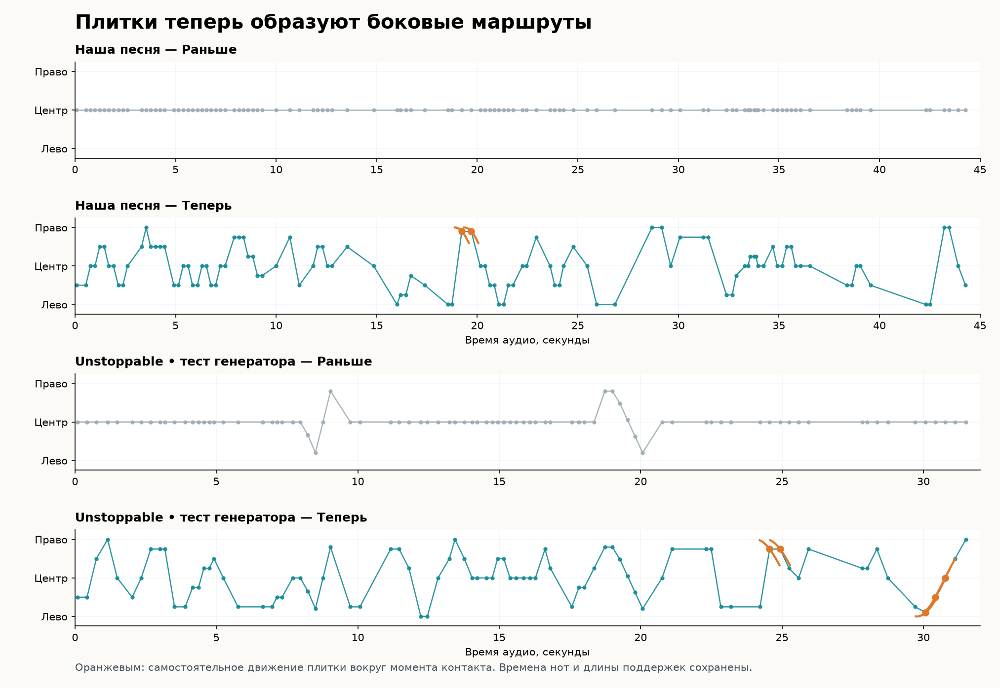
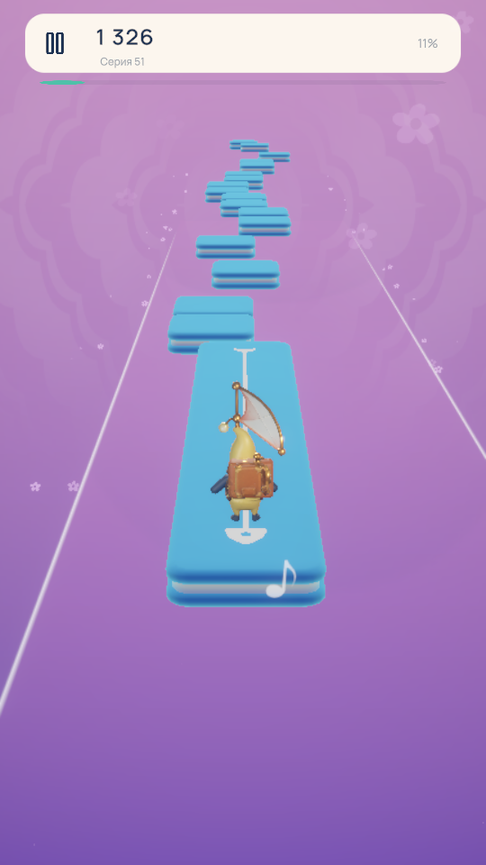

# Маршруты плиток и боковое движение, phrase-route-v1

Для обеих новых карт добавлена самостоятельная хореография: плитки стоят
слева, справа и по центру, повторяют короткие ритмические рисунки и местами
движутся поперёк дорожки. Та же обработка включена в будущую автоматическую
генерацию. Музыкальная разметка v8 сохранена: время событий, типы плиток,
длительности, границы поддержек и дальность прыжков не перенастраивались.

| Карта | Элементов всего | Слева | Справа | По центру | Движущихся влево / вправо |
| --- | ---: | ---: | ---: | ---: | ---: |
| Always Remember Meow | 333 | 130 | 99 | 90 | 6 / 6 |
| Unstoppable Generator Test | 152 | 46 | 58 | 34 | 4 / 5 |

Слева, справа и по центру считаются только логические `Jump`, `BigJump`
и `Hold`, по настоящей координате контакта. Служебные маркеры, старт,
финиш и `Follow` в эти три столбца не входят. Поэтому их сумма отличается
от общего числа элементов. Центральная область — |X| ≤ 0,05.
Направление движущейся плитки измеряется
при прохождении её точки контакта; за полный цикл оно меняется.



## На чём основаны правила

Изучены 58 оригинальных карт без их изменения: 7 315 логических опор,
7 257 переходов между ними. В **31,1% переходов сохраняется та же полоса**.
Значит, постоянное чередование «влево, вправо» не описывает наблюдаемую
расстановку. Для быстрых нот исходные карты часто используют повтор полосы
или маленькую ступеньку; более широкий переход появляется при достаточном
времени полёта.

| Свободное время после предыдущей опоры | Медиана смещения в оригиналах | 95-й процентиль |
| --- | ---: | ---: |
| Менее 0,18 с | 0,25 | 0,5 |
| 0,18–0,30 с | 0,5 | 1 |
| 0,30–0,50 с | 1 | 2 |

Среди неподвижных обычных, больших и длинных плиток 93,4% используют
позиции 0, ±0,5, ±1; 99,6% лежат на сетке с шагом 0,25. При этом разные
песни используют разные рисунки. В оригинальной Unstoppable 0.5.4 быстрые
переходы особенно часто сохраняют X, а в Twinkle встречаются короткие
ступенчатые последовательности.

Настоящие движущиеся цели есть в 48 из 58 карт. Обычная длина их группы —
две или три плитки. Все 820 изученных `Hold` неподвижны. Эти наблюдения
использованы как ориентир новой политики, а не как доказательство
восстановления закрытого генератора оригинальной игры.

## Как строится наш маршрут

`ChartRouteComposer` работает после анализа звука и компиляции карты.
Он получает уже готовые времена и типы; оригинальные карты, идентификатор
песни и её название в выборе маршрута не участвуют.

Короткая ритмическая ячейка определяет повторяемый боковой мотив.
При возвращении такой ячейки появляется зеркальный ответ. Быстрые ноты
получают повтор позиции или маленькие шаги, медленные ответы допускают
широкий переход. Первые ноты остаются ближе к центру, чтобы начало было
читаемым. Начальная и финальная опоры центрированы.

Ограничения проверяются с учётом свободного времени **после выхода**
с предыдущей поддержки: до 0,18 с допускается смещение до 0,5 единицы,
до 0,30 с — до 1, затем — до 2. Это консервативная политика компоновки,
а не объявление абсолютных возможностей движка. Сначала решаются
ограничения подхода к закреплённым опорам. Если подход невозможен,
обработка завершается ошибкой, не изгибая сохранённый путь `Follow`.

Весь существующий `Follow`, его вход, внутренние маркеры, выход и движение
сохраняются точно. Длинные `Hold` остаются неподвижными. Для бокового
движения выбираются отдельные равномерные группы `Jump`/`BigJump`, с
отступом от самого начала, финиша и других подвижных групп. Повторное
применение даёт тот же результат, включая служебные пометки карты.

## Почему движущаяся плитка попадает в нужную полосу

В существующем формате `updateType=3` означает боковой синусоидальный цикл.
Для него записанный `pos.x` задаёт **фазу**, а не мировую координату
приземления. В точке контакта действительный X равен:

`contactX = sin(2π × rawX / 5)`.

Поэтому компоновщик преобразует желаемую полосу через обратный синус:

`rawX = asin(contactX) × 5 / (2π)`.

Используется существующий цикл амплитудой 1 и пространственным периодом
30 единиц; он зависит от продвижения игрока и останавливается вместе с ним.
Поля движения элемента и сегмента синхронизируются. Проверка геометрии
сравнивает настоящие полосы контакта, а не несопоставимые фазовые числа.

У имени флага `msLeft` есть ловушка: при положительном ходе игрока
`msLeft=0` около контакта движется в мировую левую сторону, а `msLeft=1` —
в правую. Направление проверено настоящими вызовами `OriginalTile.Tick`
до и после контакта, а не выведено из названия поля.
`updateType=2` у `Follow` — отдельный режим движения вместе с персонажем;
это не автономно движущаяся цель.



Обнаружена и исправлена связанная ошибка подготовки возрождения:
для подвижной цели прежний код принимал записанную фазу за мировую
координату. Теперь `OriginalTile.ContactPosition` вычисляет настоящую
позицию контакта без перемещения живой плитки; её использует `Revive`.
Точечные проверки покрывают этот расчёт и исходную интерполяцию
подлетающей плитки. Полный пользовательский сценарий интерфейса
возрождения отдельно не проходился.

## Применение и настройки

Команда Unity **Dancing Cats → Apply routes to all custom levels**
обрабатывает только карты каталога `CustomData`. Сейчас это две новые
игровые карты. Все карты сначала проходят проверки, затем записываются.
При ошибке записи восстанавливаются прежние файлы карт и каталога.
Чужая ссылка за пределы `CustomData/Maps` или несовпадение идентичности
карты и каталога отклоняются.

- `includeRouteChoreography=true` по умолчанию включает маршрут у новых
  автоматически анализируемых песен.
- `includeRouteChoreography=false` оставляет результат анализа звука
  без нового пространственного прохода.
- `includeMovingJumps=false` отключает и прежние `Follow`, и новые боковые
  циклы; неподвижная расстановка слева/справа сохраняется.
- Режим сохранённой ручной партитуры остаётся самостоятельным: новую
  обработку не навязывают ветке возврата авторской карты.

## Что проверено

При публикации обеих карт строгие контрольные суммы музыкальных данных
до и после совпали. Отдельно совпали полные данные `Follow`; повторный
проход компоновщика оказался идемпотентным. Сохранены все целочисленные
семплы событий, типы, длительности, Z, дальности прыжков и контрольные
точки длинных поддержек.

Обе карты также заново сгенерированы из настоящего аудио в Editor.
Целочисленные семплы, типы и геометрия совпадают. Для полей `double`
при повторном чтении JSON допускается только шум сериализации до 10⁻⁸ с;
изменение времени на 0,0001 с и изменение целого семпла тест отвергает.
Это не утверждение побитового совпадения времён после любого JSON-цикла.
У прямого прохода по существующей карте контроль до/после строгий.

В настоящем Editor прошли проверки компоновщика, интеграции с анализом
PCM, отключения движения, повреждения событий, совпадения метаданных
и воспроизводимости. `OriginalTile.Tick` проверен на **20 сочетаниях**:
5 полос × 2 направления × 2 скорости. Дополнительно проверены 6 неподвижных
типов и 1 подход с интерполяцией; запрос контакта не меняет живую позу,
повтор расстояния сохраняет паузу, полный пространственный цикл возвращает
плитку в исходную фазу.

Полные свежие прогоны двух карт в Unity завершены. Их итоговые
отчёты сохранены отдельно от прежних прогонов v8: **Unstoppable, 67,004 с —
PASS; наша песня, 157,153 с — PASS**. Все 9 и 12 боковых целей соответственно
достигнуты настоящими контактами. Подтверждены смещение подвижных целей
более 0,15 единицы, оба направления движения, остановка их трансформаций
на паузе, три звезды, нормальный финиш и повтор. Перемотка, телепортация
и сокращение карты не использовались; в проверенном потоке нет ошибок
исполнения. Проверка завершилась в Edit Mode с чистой сценой.

Оригинальные 58 уровней, музыка и ручная партитура сохранены; проверяются
410 защищённых файлов. Модели и анимация курьеров не менялись. Сборки
игрока не создавались. Этот шаг добавляет пространственную игровую политику,
но не исправляет оставшиеся ограничения определения типов плиток,
описанные в [отчёте музыкального генератора v8](../ChartCalibration/V8/README.md).

## Доказательства

- [Измерения 58 оригинальных карт](original-study.json),
  [пояснения исходного исследования](original-findings.md).
- [Итоговые численные результаты](summary.json), [проверка целостности](integrity.json).
- [Проверки Editor](unity-checks.txt).
- Полные прогоны: [Unstoppable](unity-original-playtest.txt),
  [наша песня](unity-custom-playtest.txt).

Повторить исследование из корня репозитория можно командой:

```powershell
python Tools/RhythmAnalysis/study_chart_routes.py
```

Скрипт читает оригинальные карты, записывает результат только под
`DancingCatsClone/Library/ChartChoreographyV1/Reference` и проверяет хеши
всех 58 источников после анализа.
