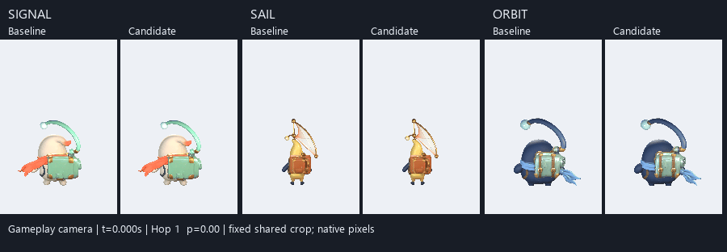
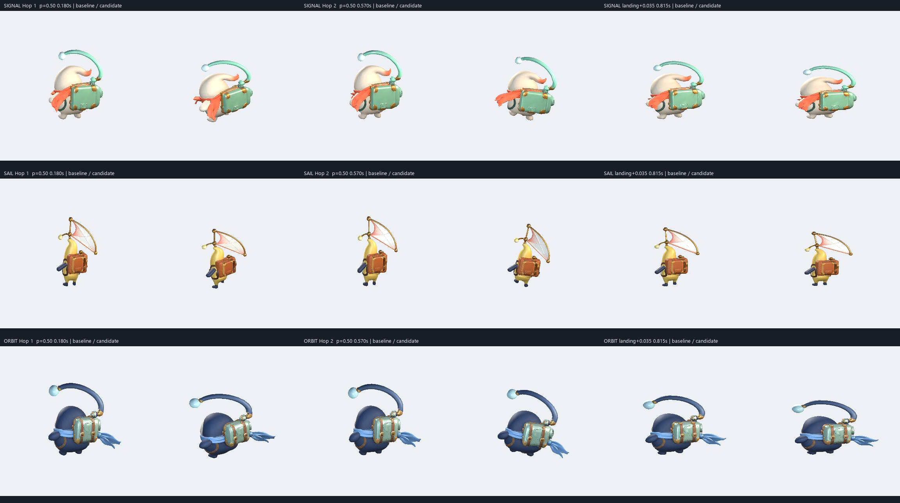

# Чередование прыжков и упругое тело курьеров

26 октября 2026. Сравнение с исходной версией `bcbbd81`.

Обычные прыжки теперь чередуют левую и правую сторону персонажа: первый — наклон влево с левой опорной стопой, следующий — вправо с правой. Свободная стопа поджимается выше. Корпус слегка поворачивается и переносит визуальный вес, поэтому задний силуэт меняется между прыжками. Сжатие и вытягивание продолжаются в полёте и становятся заметнее при контакте.

В каждой паре слева исходная анимация, справа новая. Это кадры настоящих импортированных моделей и runtime-анимации Unity с геометрией игровой камеры. Общий вырез из кадра 288×512 сохранён в исходных пикселях; фон здесь диагностический.

Изменения сосредоточены в [CourierMotion.cs](../../../DancingCatsClone/Assets/RadioArchipelago/Runtime/CourierMotion.cs):

- Сторона выбирается один раз при `PlayJump`; контакты и обновления прогресса её не переключают. `ResetMotion` начинает последовательность снова с левой. Чередование полных оборотов на поддержках имеет собственную последовательность.
- Целевой наклон корпуса достигает ±12°, небольшой поворот — ±16°. Визуальный перенос веса и разная высота стоп поддерживают тот же жест: свободная стопа поднимается на 0,14–0,18 локальной единицы, опорная — примерно на 0,012. Это цели анимации; фактические углы после сглаживания приведены ниже.
- Форма тела напрямую следует нормализованной фазе реального полёта: вытягивание после отталкивания, сборка к вершине, повторное вытягивание перед контактом. Поверх неё остаётся меньшее непрерывное колебание. Поперечный масштаб компенсирует высоту и сохраняет объём тела.
- Импульс приземления усилен и расширен по времени. Вытягивание следующего прыжка больше не гасит сжатие, когда контакт и новый взлёт происходят подряд.

Игровой контроллер, корень движения, коллайдеры, музыкальные часы, карты, аудио, модели, материалы и настройки проекта не редактировались. Игровая камера сохранена.

Оригинальный кот использован как ориентир для постоянной деформации. В восстановленном `Jump.anim` есть зацикленная секундная кривая масштаба с высотой 1,10 и 0,90; стопы в этом клипе статичны. Чередование опорных ног и наклонов — новая анимация курьеров. Подробные ключи, пути и границы выводов сохранены в [разборе оригинала](reference.md).

Сопоставлены по 117 поз для исходной и новой версии: Тико (`signal`), Люмен (`sail`) и Нори (`orbit`), короткая пара прыжков и длинный полёт, три ракурса. Во всех 351 проверках каждого набора геометрия помещается в кадр. Камеры, освещение, материалы, пути префабов и масштаб экземпляра 0,47 одинаковы. Поле диагностической камеры расширено с 40% до 60%; после этого обе версии сняты заново с одинаковыми параметрами — [framing.json](framing.json).

| Измерение | До | После |
|---|---:|---:|
| Наклон корпуса в середине первого / второго короткого прыжка | +0,36° / +1,16° | +7,21° / −6,09° |
| Разница высот центров реальных стоп: левая минус правая, первый прыжок | около 0 | −0,086…−0,071 |
| Та же разница, второй прыжок | около 0 | +0,074…+0,088 |
| Масштаб Y: короткие прыжки и приземление | 0,850…1,110 | 0,790…1,148 |
| Масштаб Y: длинный полёт и приземление | 0,826…1,089 | 0,760…1,154 |

Высоты стоп измерены по центрам настоящей деформированной геометрии в мировых единицах, а не только по управляющим костям. Диапазоны масштаба включают приземление; деформация внутри полёта дополнительно проверена отдельно. Полные измерения находятся в [summary.json](summary.json), краткое визуальное заключение — в [findings.txt](findings.txt).

В игровом масштабе сапоги всё ещё занимают несколько пикселей. Поднятая стопа частично скрыта телом и рюкзаком, особенно у Нори. Чередование лучше читается по наклону корпуса и нижней опорной стопе; [увеличенные фрагменты стоп](gameplay-feet-detail.png) показывают подробности без сглаживания пикселей. Сравнения отдельных курьеров: [Тико](signal-comparison.gif), [Люмен](sail-comparison.gif), [Нори](orbit-comparison.gif); длинный полёт: [Тико](signal-long-comparison.gif), [Люмен](sail-long-comparison.gif), [Нори](orbit-long-comparison.gif). GIF сохраняют снятые позы без интерполяции; интервалы округлены до 10 мс, последний кадр удерживается 400 мс для читаемости цикла.

Проверки в Unity подтвердили 18 групп сценариев, включая чередование, деформацию полётов 0,30 / 0,45 / 0,65 с при 30 / 60 / 120 кадрах/с, согласованность фаз, контакт с немедленным взлётом, паузу, сброс, перепривязку рига и жесты в длинном полёте. Они измеряют фактические Transform и проверяют сохранение игрового корня и коллайдера. До изменения тот же набор дал 15 ошибок — [исходный результат](checks-red.json); после изменения `radio-hop-checks` и существующие `radio-motion-checks` прошли — [результат](checks-green.txt). Существующие проверки аксессуаров и ригов также прошли — [compatibility-checks.txt](compatibility-checks.txt).

Оба полных игровых прогона прошли: [Jingle, 64,000 с](unity-jingle.txt) и [наша AlwaysRememberMeowCat, 157,153 с](unity-our-song.txt). Проверены настоящие контакты с плитками, пауза и продолжение, итоговый экран, повтор и восстановление исходного состояния после проверки; runtime-ошибок не обнаружено. [Кадр из игрового прогона](gameplay-actual.png) показывает модель в полном окружении. Карту и музыку нашей песни не меняли и не генерировали заново; общая новая анимация применяется и к ней.

[Финальная проверка целостности](integrity.json) подтвердила точное совпадение SHA256 всех 624 защищённых файлов с исходным снимком. Совпадают параметры съёмки, проверены суммарно 234 позы настоящих моделей и 702 попадания геометрии в кадр. Хеш текущего `CourierMotion.cs` совпадает с исходником, использованным для новой съёмки. После проверок [состояние предпросмотра](unity-preview.json) — Play Mode, меню с выбранной `AlwaysRememberMeowCat`, часы 0, компиляция завершена, сцена без несохранённых изменений. Сборки игрока не создавались; производительность и субъективное звучание этим отчётом не оцениваются.

В архиве сохранены [исходный CourierMotion](Source/CourierMotion.before.cs.txt), [скрипт сравнения кадров](ReproTools/make_comparisons.py) и [скрипт упаковки и проверки](ReproTools/package_review.py). Для повторного запуска скрипты нужно вернуть непосредственно в `DancingCatsClone/Library/CourierHopReview` вместе с каталогами кадров, `before.json` и игровыми логами. Снимок из `Source` должен лежать там как `CourierMotion.before.cs.txt`, а [запись первоначальной узкой съёмки](Notes/narrow-framing-candidate.json) — как `NarrowDiagnostic/Candidate/metrics.json`. Скрипты зависят от этой структуры, текущего проекта и Pillow; они не являются самостоятельными CLI. Узкая съёмка оставлена только как след диагностики одного обрезанного кадра; итоговое сравнение использует повторную съёмку обеих версий с одинаковым расширенным полем.
