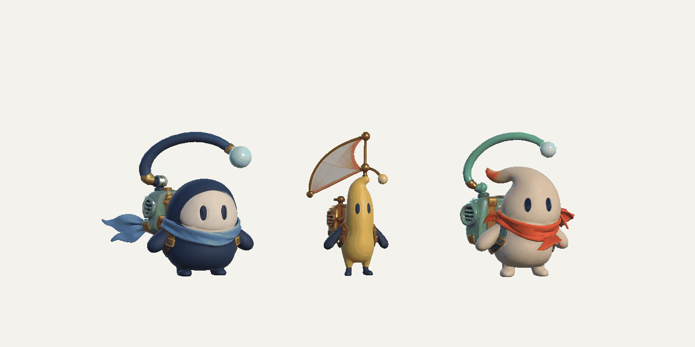

# Шарфы, антенны и парус: реализация

Запрос от 24 октября 2026: свободные концы шарфов Тико и Нори изгибаются
цепочками, отстают при поворотах и реагируют на полёт и приземление. Антенны
качаются на креплении; в длинном полёте медленно вращаются вокруг вертикали.
У Люмена удаляется нижняя перемычка от рюкзака к краю паруса. Парус качается
на коротких прыжках и вращается в длинном полёте и прокате; при вращении
персонажа его собственное вращение направлено в противоположную сторону.

Используется существующая пружинная анимация костей CourierMotion. Отдельная
кость antenna.yaw задаёт шарнир, дочерняя цепочка сохраняет небольшую гибкость.
Инерция и вращение независимы. Добавление Rigidbody и Cloth потребовало бы
другого порядка обновления и усложнило управление музыкальным временем;
здесь анимация остаётся визуальной и воспроизводимой при паузе и перемотке
редакторского просмотра.

План:

- [x] Подготовить модели в отдельном Blender, сохранить UV, исходные карты,
  моргание и плечевые риги; проверить удаление только отмеченной перемычки.
- [x] Добавить antennaYawPivot в привязку; разделить наклон и вращение,
  усилить запаздывание цепочек шарфа с ограниченными углами.
- [x] Импортировать модели в Unity с прежними GUID и игровыми ID;
  пересчитать границы отсечения для поворота аксессуаров во все стороны.
- [x] Проверить короткий прыжок, длинный полёт, оба направления проката,
  прерывание полёта, паузу, сброс, скачок времени и реальные вершины skin.
- [x] Посмотреть настоящие кадры и анимации Unity; проверить меню и игровой
  прогон, затем вернуть Editor к просмотру. Музыку и карты не менять, билды
  не создавать.

## Результат в Unity

Все три импортированных рига прошли проверки настоящих деформированных
вершин, моргания, плеч и мировых границ отсечения. Короткий прыжок не
запускает оборот; за длинный полёт 2,4 с антенна поворачивается примерно
на 224°. При полном обороте корпуса на прокате шарнир даёт противоположный
поворот в мировых координатах примерно на 264°. Пауза, сброс и задержка
кадра проверены отдельно. Это управляемая пружинная анимация костей.

Проверены девять случаев меню и полные игровые прогоны 157,153 и 67,004 с.
Музыка, исходная Unstoppable и игровые траектории сохранены. Последняя
геометрическая правка углубляет крышки шарниров на 0,004, устраняя
совпадающие поверхности без смещения наружных колец; после неё повторены
проверки skin и съёмка обеих анимаций.

Просмотр: `Radio Archipelago > Animation Preview`. Проверка движения:
`Radio Archipelago > Imported couriers > Check accessory motion`.
Переносимые отчёты, авторинг и 48 кадров каждой анимации:
[RigReview/Accessories](RigReview/Accessories).

