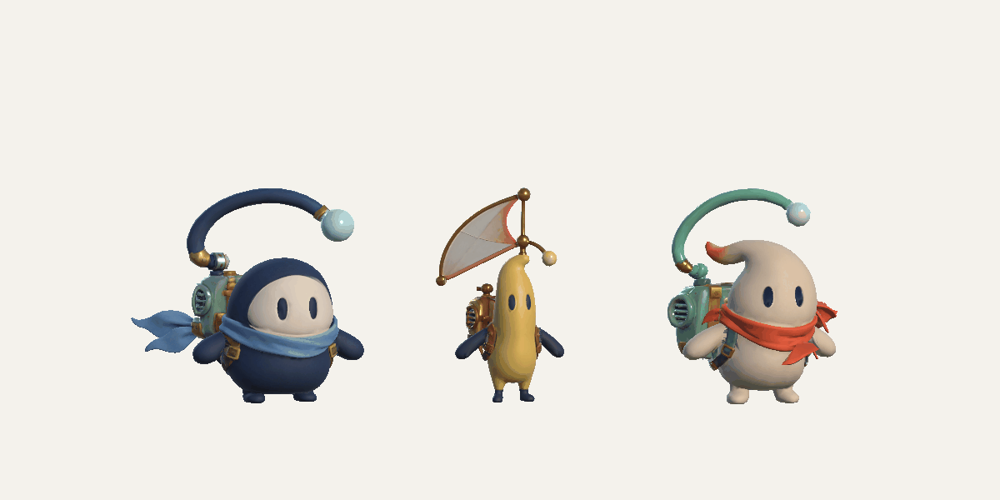

# Плечевые махи и отдельные лапы

Требование пользователя от 24 октября 2026: повторить характер махов
оригинального котика, но сохранить собственных персонажей. Последнее уточнение
заменяет прежнее требование цельного плеча: лапы нужно аккуратно отделить,
основания скрыть внутри корпуса, чтобы текстура больше не растягивалась.

## Что измерено в оригинале

Из сохранённого `Cat01.controller` взят фактически подключённый `Jump.anim`,
а не похожий ролик. Клип длится одну секунду, зациклен, частота 60 Гц,
скорость состояния — 1. У плечевых узлов `Shou01/s001_AN` и
`Shou02/s002_AN` зеркальные вращения Z: +50…−25° и −50…+25°.
Лапы работают одновременно: четыре полных маха в секунду, размах 75°.
Ключи имеют сглаженные остановки в крайних положениях. Параллельно в исходной
анимации двигаются локальные позиции лап; например, диапазон Y первого
контрола — −0,067…+0,084 в исходных единицах.

`OriginalPawMotionStudy.Run()` воспроизводит именно этот клип на исходной
геометрии во временной сцене, сохраняет 60 кадров и числовые кривые в
`DancingCatsClone/Library/RadioRigging/OriginalPawStudy`. Материалы только
для этого просмотра переведены на URP/Lit; освещение не воспроизводит
оригинальный рендер. Исходные ассеты и игровой проект этим просмотром
не изменяются. Бесконечные тангенты постоянных каналов в JSON представлены
нулём; времена и значения ключей сохранены.

SHA-256 исследованных файлов:

- `Jump.anim`: `8a8ea0c75b4566089b676fa528a492342aa58b8796c3e32f72f062bba93112e4`
- `Cat01.controller`: `cbbbb260f8a2c8c5495581d8c2a2feed309aa05e771a2be5ba206e44247a2707`

## Самостоятельное исполнение на наших героях

`CourierMotion` вычисляет сглаженный зеркальный мах с тем же темпом 4 Гц.
Длинный полёт задаёт диапазон цели −10…60° относительно плечевой исходной
позы; короткий прыжок использует меньшую амплитуду. Начало и конец перелёта
плавно подмешивают жест. Обе руки двигаются синхронно, каждая вокруг своего
плеча. Отдельная быстрая реакция плеч не даёт медленному сглаживанию корпуса
погасить мах. Исходные клипы или контроллер кота не подключаются к нашим ригам.

Лапы вращаются целиком. Их скрытые основания перекрывают поверхность корпуса;
руки не удлиняются, локтевой излом и растягивающийся переход весов не нужны.
Текстуры и наружная форма берутся из присланных моделей, а не заменяются
геометрическими примитивами. Шов проверяется на нижнем и верхнем положении.
Под лапами восстанавливается округлая поверхность торса. Исходные файлы
4K-текстур сохраняются побайтно; UV и нормали нетронутых участков также
сохраняются. У локально восстановленного плеча и внутренних крышек UV
назначаются на чистый участок родного атласа, чтобы убрать старые запечённые
тёмные следы контакта и сделать цвет продолжением корпуса.

Шарфы используют четыре сустава на каждый конец и один общий бюджет изгиба
до 68° на ветвь. Более мягкие пружины и бегущая по цепочке волна делают
изгиб заметнее. На движение влияют не только поза и поворот, но и измеренные
скорость и ускорение игрового корня. Измерение выполняется один раз за кадр,
пружины — ограниченными подшагами; сама анимация не передвигает корень.
Повторный вызов `SetPaused(false)` не сбрасывает инерцию; сброс происходит
только при настоящей смене состояния паузы.

## Проверка

Редакторские проверки используют настоящие импортированные вершины: четыре
пика махов за секунду, противоположные знаки движения левой и правой лапы,
видимое перемещение лап, постоянную длину рёбер, скрытые крепления, полёт,
повороты, встречное вращение антенны, паузу, сброс и границы отсечения.
Ролик Unity снимается в 40 кадров/с, чтобы махи 4 Гц не терялись в редких кадрах.
Сборки игры для этой работы не создаются.

## Итоговая проверка в Unity

Все три финальных FBX повторно импортированы с прежними GUID. Настоящие
вершины лап имеют ровно одну плечевую кость, без мостиков с корпусом.
Измерены четыре маха за секунду с обеих сторон; диапазон подъёма примерно
−8…59°, ошибка зеркальности не больше 1,47°. Максимальное относительное
изменение длины ребра в визуальной системе координат — 0,00031
(0,031%, погрешность вычислений skin); общий squash корпуса исключён из измерения.

240 настоящих кадров Unity сняты при 40 fps. Девять случаев меню — три героя
на 540×960, 390×844 и 1080×1920 — прошли проверку отсечения. Полный
Unstoppable v5 с финальными моделями 67,004 с пройден через настоящий ввод,
с удержаниями, прокатами, паузой, тремя звёздами, повтором и возвратом.
Ранее этой же новой runtime-анимацией пройден полный трек 157,153 с.
Профиль и чистая сцена восстановлены.

Источники и отчёты:

- [Подготовка, исходные виды и точные SHA](RigReview/Paws/source-summary.md)
- [Жёсткие лапы и четыре маха](RigReview/Paws/unity-rigid-paws.txt)
- [Риги, моргание и culling](RigReview/Paws/unity-rigs.txt)
- [Свободные аксессуары, пауза и сброс](RigReview/Paws/unity-accessories.txt)
- [Меню](RigReview/Paws/unity-menu.txt), [игровой прогон](RigReview/Paws/unity-playtest.txt)

