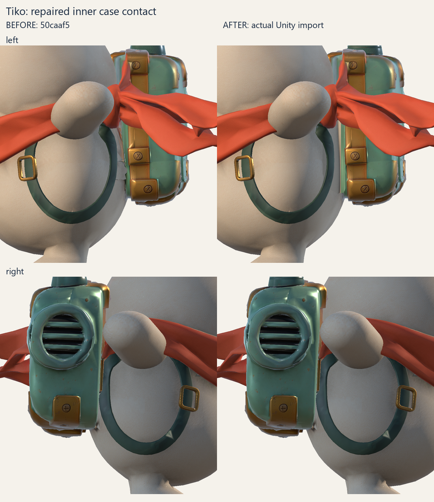
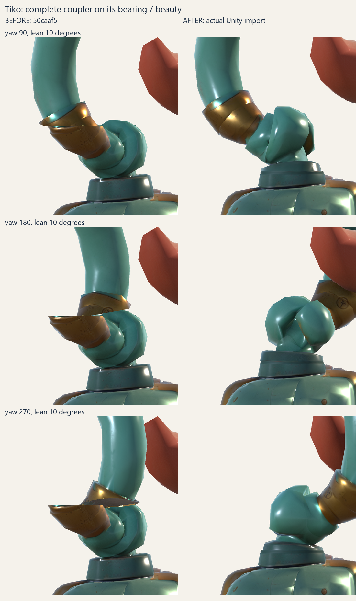
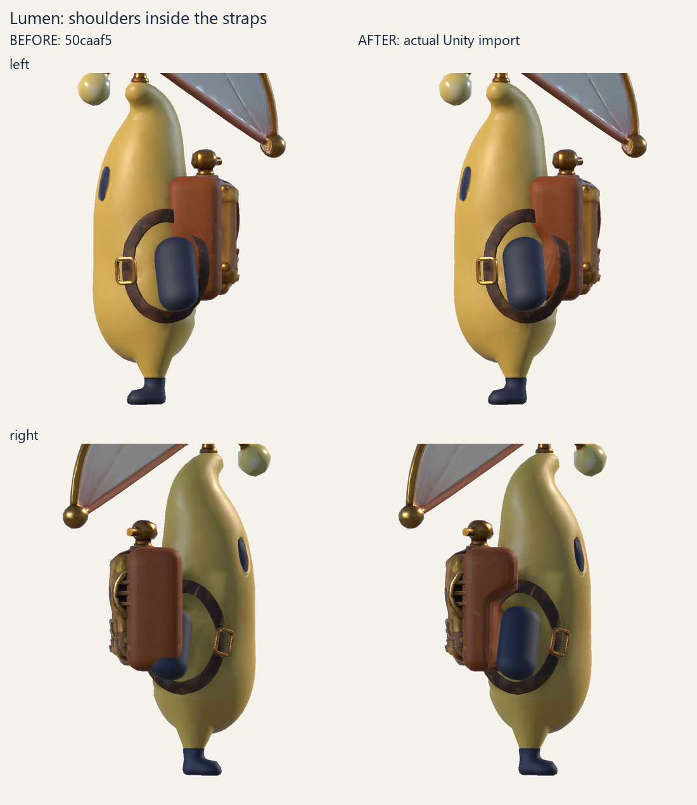
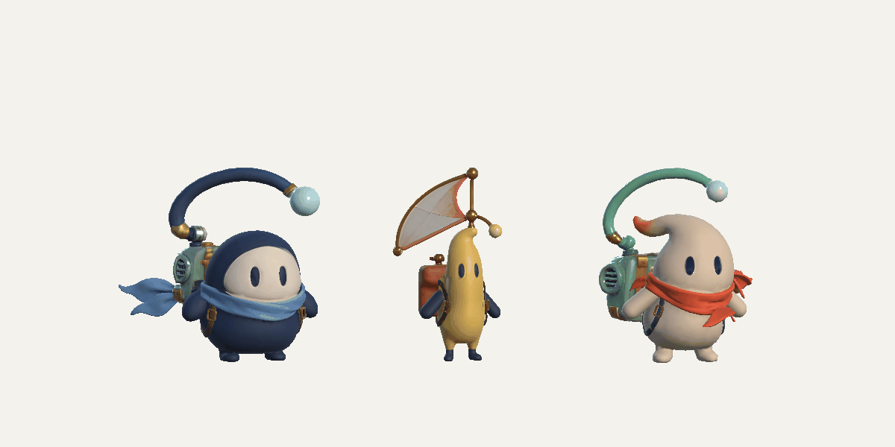

# Case, bearing and shoulder corrections — 25 October 2026

The published Tiko and Lumen packages replace baseline `50caaf5`. Nori is
unchanged. All changes use the supplied character meshes and existing 4K maps;
music, original/test levels and player settings are outside this change.

| Courier | Triangles | Skinned objects | Bones |
|---|---:|---:|---:|
| Tiko | 22,372 | 4 | 23 |
| Lumen | 29,972 | 5 | 12 |
| Nori, unchanged | 19,732 | 4 | 21 |

## Result

Tiko's pale, stepped inner edge combined folded source case geometry with a
generated tissue fan and a retained old harness stub. A local cut/reconnect
replaces 153 triangles with 835 curved triangles. Tissue uses cream cloth;
the case edge uses native green metal. The gold strip stays in place. On the
vent side only three authorised source UV faces change. Retained skin, shape
keys and geometry outside the patch are preserved. Normal vectors are
re-encoded against the new corner fans instead of copying obsolete encoded
values. The four original open edges remain inherited; no new boundary is
introduced.

The old antenna cut passed horizontally through a diagonal coupler, leaving a
stationary brass flap and an offset rotation centre. The whole coupler now
rotates above the circular pedestal. Yaw is centred at
`(-0.579950, 0.552197, 1.45)`; flexible lean starts above it at
`(-0.80, 0.72, 1.76)`. Only a 12-mm socket band is reconstructed. Both overlapping
walls are concentric cylinders; their tapers finish outside the overlap.
Actual surface tests cover 18 yaw/lean cases, with no intersections and a
minimum measured radial clearance of 0.279 mm. This checks the complete walls,
rather than assuming the terminal ring clearance proves the whole bearing.

Lumen's complete rigid paws and rest bones move forward by **0.07 source units**,
with their previous inclination, shape, size and UVs. Their pivots seat inside
the torso. Both paws fit inside the actual harness aperture; the imported Unity
margin is at least 0.02876 world units. Only the previously generated leather
backplate is recessed to clear the natural shoulder position. All 3,998 older
contact/source case faces retain their geometry, UVs and weights. The complete
model stays below the 30,000-triangle budget.

The [translation trials](placement-trials.json) record actual imported skins
against the unchanged harness. Original placement fails at the rear; excessive
forward shifts fail at the front. This is why the final gate measures the strap
opening and real 3D intersections instead of requiring the whole paw to be in
front of every point of the backpack. Independent triangle BVH checks found no
paw/Pack or paw/Harness intersections in all eight sampled paw poses. Minimum
Pack clearance is 11.94 mm; Body, Harness, Blink and the ten non-arm rest bones
are unchanged.

## Validation and reproduction

Both packages were rebuilt by the canonical pipeline from the pinned source
revisions, then independently exported/reimported as FBX. The final source,
helper hashes, payload hashes and strict transport measurements are recorded in
[Tiko freeze](freeze-Tiko.json) and [Lumen freeze](freeze-Lumen.json). No manual
changes were merged into the exported canonical files. Reproduction commands
and the five externally supplied source ZIP prerequisites are documented in the
[authoring tools](../../../../../ArtSource/RadioArchipelago/Tools/README.md).

[Case QA](case-qa.json), [bearing QA](bearing-qa.json),
[shoulder QA](shoulder-qa.json) and the
[independent canonical audit](independent-attachment-audit.log) describe the
source-level checks. [Integrity](integrity.json) records the final runtime bytes,
the unchanged nine PNGs and the unchanged song/map inputs.

The [Unity action log](unity-final-actions.txt) records the actual import,
rigid/rounded paw, rig, accessory, joint, menu, motion and content checks.
The [before manifest](unity-before-joints.json) and
[after manifest](unity-after-joints.json) identify the actual prefab dependencies
behind the captures. The latter contains 82 lit/clay frames: both case sides,
seven antenna yaw angles with two lean values from two directions, and both
Lumen shoulders from three directions in three poses. The antenna camera stays
fixed throughout each rotation sweep. The [plain clay comparison](Tiko-antenna-clay.png)
is preserved separately from the PBR images.

The [menu report](unity-menu-checks.txt) covers all three couriers at three
viewport sizes. [Rig](unity-rig-checks.txt), [rigid paws](unity-rigid-paw-checks.txt),
[rounded paws](unity-paw-shapes.json), [accessories](unity-accessory-checks.txt)
and [content](unity-content-checks.txt) cover their respective domains. The
preview GIFs use real imported Unity skins and the runtime motion component in
a disposable stage; they are not a recording of a full song.

No player build was created. The earlier full Unstoppable playthrough belongs
to the preserved baseline; this corrective pass validates the changed geometry,
rigs, motion and UI without regenerating or shortening either level.
