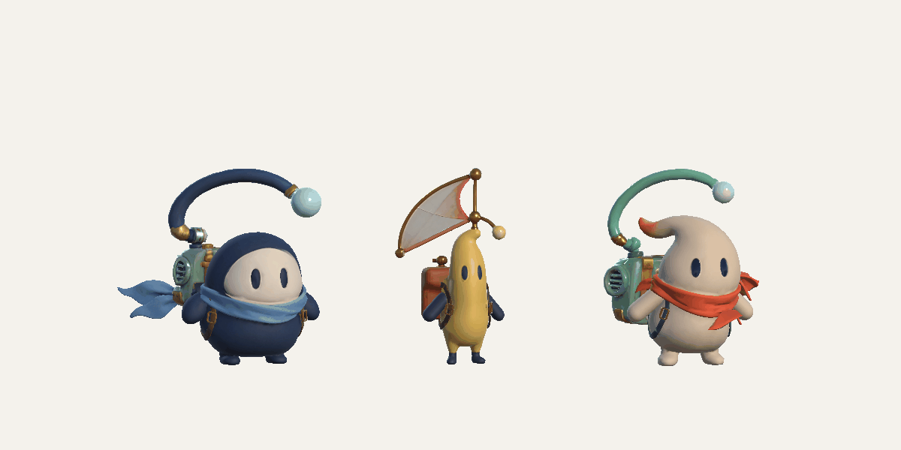

# Обороты, инерция и пружинящее тело

25 октября 2026. Модели, текстуры и материалы из `ce6a3c2` сохранены.
Изменено поведение `CourierMotion` и его вызов при входе на поддержку.

- Каждая длинная поддержка получает один полный оборот. Направление
  чередуется независимо от типа Hold/Follow. Проверены длительности
  0,18 / 0,35 / 0,65 / 1,4 с; новая попытка сбрасывает последовательность.
- Контроллер передаёт настоящее оставшееся время поддержки. Прежние
  ограничения «минимум 0,5 с» и «вращать только дольше 0,9 с» убраны.
- Шарф, антенна и парус получают запаздывающую реакцию, направленную против
  движения мышью. Сила переводится в систему настоящего крепления, включая
  отдельный вращающийся шарнир антенны. Проверяется мировое направление
  реальных вершин при повороте тела на 90° и 180°.
- Центр инерционного изгиба определяется по взвешенной геометрии при
  привязке. Невзвешенные конечные кости, не двигающие видимый парус Люмена,
  исключены из распределения изгиба; необходимые кости-предки сохранены.
- Тело постоянно сжимается и вытягивается при ожидании, прыжке и прокате.
  Поперечный масштаб компенсирует изменение высоты. Корень движения,
  коллайдеры, длительность музыкального полёта и игровые часы не меняются.
- Бюджет изгиба общий для ветра и инерции. Для ткани он ограничен
  45° целью и 48° состоянием; более быстрая пружина сохраняет заметный
  отклик без прежнего сильного растяжения у крепления к телу.

## Настоящие кадры Unity

Две последовательные поддержки по 1,3 с, затем 0,4 с успокоения.

Рендер временной сцены Editor: настоящие импортированные модели, текстуры,
скиннинг и runtime-анимация. Каждый ролик содержит 120 кадров, 3 с, 1200×600.
Только временные стойки задают иллюстративную траекторию; игровая сцена и
ассеты не сохраняются. Кадры не генерировались нейросетью.

## Проверки

Свежий Editor подтвердил motion, accessory и rigid-paw проверки.
[Отчёт реальных вершин](accessory-checks.txt) содержит подписанные смещения,
противоположное вращение флюгера, сохранение креплений и проверки геометрии,
включая сильное движение во время вращения. Пауза, сброс и восстановление
позы проверяются отдельно. Измерения геометрии и временные Mesh нужны
только при привязке рига; в кадровом цикле чтения мешей нет.

Финальные игровые прогоны и команды сохраняются вместе с
[отчётом генератора](../../../../Clone/ChartCalibration/V7_FLIGHTS_AND_PATHS.md).
Сборки игрока не создавались.
