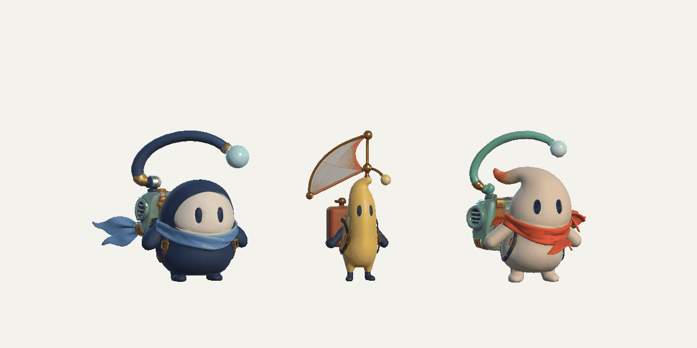

# Rounded paws and underarm repair — 25 October 2026

This report preserves the `50caaf5` baseline. The later case, antenna and shoulder
corrections, with current package evidence, are in
[JointCorrections](../JointCorrections/README.md). The package paths below now
contain that newer revision; this folder's images and integrity snapshot remain
the historical baseline.

Tiko-v3, Nori-v3 and Lumen-v2 are exported, imported and reviewed in Unity
6000.5.4f1. Final pose, animation, menu and full Unstoppable comparison-flow
checks passed. No player build was created.

## Changes

The new paw starts with the supplied model's good rounded fingertip. That distal
surface is reflected across its equator, joined into an elongated double-rounded
shape and mirrored to the other anatomical shoulder. Each paw binds completely
to its own shoulder bone. The previous jagged root fans are removed.

The exposed body uses a local smooth surface fitted to healthy surrounding
tissue. Folded contact rims are repaired locally, including defective source
anchors where necessary. Separate closed harness ribbons and bevelled buckles
sit on the body. Atlas charts retain native detail and use matching colour,
normal, metallic and roughness regions; a colour-only check missed several of
the earlier defects.

The existing Blink, scarf chains, antenna joints and shoulder-driven animation
remain. The original character ZIP archives and all nine 4096² texture files
retain their original bytes. Music and the original Unstoppable map are outside
the model pipeline. No player build is created by these tools.

| Current accepted package | Triangles | Skinned objects | Bones |
|---|---:|---:|---:|
| Tiko-v3 | 21,174 | 4 | 23 |
| Nori-v3 | 19,732 | 4 | 21 |
| Lumen-v2 | 26,868 | 5 | 12 |

Each paw has 1,936 / 1,862 / 1,960 triangles for Tiko / Nori / Lumen,
respectively. The complete courier budget is 30,000 triangles. Paw topology,
rigid weights and sampled shoulder poses are checked independently of the body.

Lumen's original fused back/case interface is replaced by a closed body surface
and a separate closed Pack skin. The radio controls, grille and main exterior
panels retain their supplied shape. The hidden front rim has 194 deliberately
flattened vertices; these are marked as authored, with separate origin
attributes for tracing their source. Actual eyes/Blink, feet and antenna are
checked independently of bone names: 82 head-weighted radio-control vertices
move to the Pack object without changing position. Pack has no empty Blink
shape, so the runtime continues to select the actual eye morph on Character.

The Pack contact is covered by a closed leather backplate with an 85-mm rounded
rim, adding 2,700 triangles inside the same Pack skin. It covers the old ragged
contact without moving the original grille, controls or outer-case vertices.
Its new vertices bind only to `body`. The local atlas selection checks every
source texel block with a padded footprint: accepting a few percent of unrelated
atlas had left visible white streaks on the first version. The final panel uses
only native nonmetallic leather; the underlying contact also uses brown casing
UVs. Character, both paws and Harness are unchanged by this Pack finish.

The final body/back seam uses the old side's boundary normals and a two-ring
transition to the actual new mesh normals. This removes the straight shading
seam after the folded geometry itself has been removed. The original maps and
new back's positions, UVs, weights and Blink are unchanged by that shading step.

## Verification contract

Authoring checks cover finite triangles and UVs, rigid paws, Blink, the original
texture hashes and final body topology. The body gate compares every remaining
open edge with its immutable source endpoint IDs and positions. A simple count
allowance would miss a newly opened hole when an old hole had been closed.
Deleting a new Nori triangle or a Tiko triangle is correctly rejected; see
[negative probes](topology-negative-probes.json).

Nori and Lumen have no open body edges; Lumen's Pack is also closed. Tiko retains
four inherited source boundary edges, whose identities and positions are
checked. The complete couriers introduce no new open boundaries.

Independent FBX import checks the portable artist file against the runtime FBX:
positions, corner normals, UVs, weights, bones and Blink. These measurements show
transport fidelity; they do not establish visual quality. Actual imported Unity
pawns are also measured for matching rounded ends and elongated proportions.
The old cut revision fails that shape check:
[before-paw-shape.json](before-paw-shape.json).

Visual review uses the actual imported prefabs, three shoulder poses
(-10°, 30°, 60°), six directions including both undersides, and both lit PBR and
untextured material. The 108-frame candidate manifest records Unity version,
capture time and prefab dependency hashes. Baseline captures predate these
repairs and are preserved separately. Animation and menu validation follow the
final import; neither a static render nor numeric source checks replace them.

## Reproduction

The canonical entry point is `prepare_radio_rigs.py --stage rounded`, documented
in the [authoring tools](../../../../../ArtSource/RadioArchipelago/Tools/README.md).
It reads the pinned separated-rig revision `87bc426` and the pre-cut surface
revision `d8019f2a8b00f1c6481c1a086056ebc543c6f1e9`, verifies the cached Git blobs,
and applies the current deterministic helpers. Manual changes in `Processed`
are not merged into those inputs.

Fresh-process semantic reconstruction is verified for
[Tiko-v3](tiko-canonical-repro.json) and
[Nori-v3](nori-canonical-repro.json), and for all five roles of
[Lumen-v2](lumen-canonical-repro.json). Nori's paw vertex indices and Lumen's
Pack vertex indices may be reordered
by BMesh; triangle-corner positions, UVs, normals, weights and Blink preserve the
same surface. Raw binary identity is not the reconstruction criterion.
After those runs, one whitespace-only line in the torso helper was cleaned up.
[AST equivalence](formatting-equivalence.json) records the raw hashes and
confirms that the executable Python syntax tree is identical.

Tripo semantic labels reconstructed from the original ZIPs agree with the
inspection-cache labels for all 14,704 Nori and 24,454 Tiko prepared source
faces in one Blender process. See
[semantic-fallback-repro.json](semantic-fallback-repro.json). This guards a
checkout from depending on ignored inspection data, provided the supplied local
ZIP archives have been restored. Those five source archives are deliberately
excluded from Git; their required paths, sizes and hashes are listed in the
authoring tools README linked above. The imported game does not need them.

Frozen package manifests live beside the artist and runtime files:
[Tiko](../../../../../ArtSource/RadioArchipelago/Processed/Tiko/manifest.json),
[Nori](../../../../../ArtSource/RadioArchipelago/Processed/Nori/manifest.json),
[Lumen](../../../../../ArtSource/RadioArchipelago/Processed/Lumen/manifest.json).
Authoring reports inside a manifest describe the state at that step; final
visual acceptance and Editor evidence belong to this review.

## Final Editor evidence

[Action log](unity-final-actions.txt) records the import, rig, rigid-paw,
rounded-paw, accessory, surface, menu, reel, content, chart and full-song jobs.
All authoring jobs ended outside Play Mode with a clean scene. The
[full 67.004-second flow](unity-unstoppable-playtest.txt) selected all three
couriers, exercised the new UI through actual pointers, completed the recording
with the final selected Tiko, and tested Hold/Follow contacts, pause/DSP,
results, retry and return home. It restored the profile and Editor state and
reported no runtime errors. This is one complete song run, not three separate
full runs with each courier.

The [rig report](unity-rig-checks.txt),
[rigid binding report](unity-rigid-paw-checks.txt),
[six imported paw shapes](unity-paw-shape-checks.json),
[accessories](unity-accessory-checks.txt),
[nine menu cases](unity-menu-checks.txt) and
[content/reference checks](unity-content-checks.txt) cover their respective
domains. The [surface manifest](unity-surface-manifest.json) identifies the
actual prefab dependency hashes behind all 108 final captures. Final package
hashes, source texture equality and unchanged original song/map are recorded in
[integrity.json](integrity.json); the Lumen source/payload freeze is also saved
in [lumen-freeze.json](lumen-freeze.json).

Before/after sheets show raised shoulders at 60 degrees from front, both sides
and below, using actual Unity renders:

| Character | Supplied PBR material | Plain clay material |
|---|---|---|
| Tiko | [Before/after](Tiko-beauty-before-after.png) | [Geometry](Tiko-clay-before-after.png) |
| Nori | [Before/after](Nori-beauty-before-after.png) | [Geometry](Nori-clay-before-after.png) |
| Lumen | [Before/after](Lumen-beauty-before-after.png) | [Geometry](Lumen-clay-before-after.png) |

The opposite underside is separately saved for
[Tiko](Tiko-under-left-unity.png), [Nori](Nori-under-left-unity.png) and
[Lumen](Lumen-under-left-unity.png). Lumen's final front is visible
[here](Lumen-front-unity.png), including the closed rounded radio backplate.

The previews below use the imported Unity skins, supplied textures and the
runtime motion component in a disposable review stage. Each contains 120 actual
rendered frames over three seconds; these are animation previews rather than a
recording of the full gameplay run. See [reel provenance](unity-reel-manifest.txt).

The audio calibration remains limited to this recording. The generator now
matches all 14 Hold and both Follow intervals, with no extra long supports;
ordinary entries, BigJump and some Follow paths still differ from the original.
See [the calibration report](../../../../Clone/ChartCalibration/README.md) for
timing tolerances and the complete comparison. Music and the original level
are unchanged.
